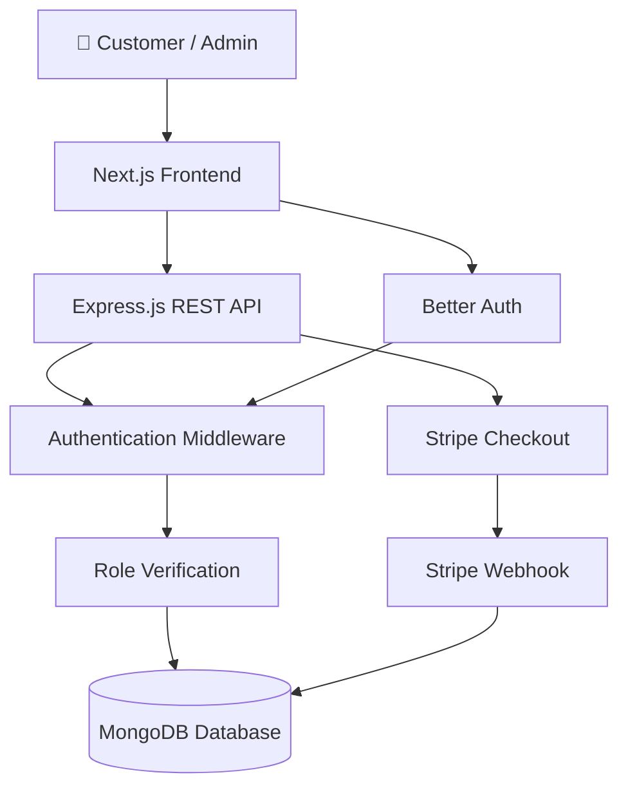
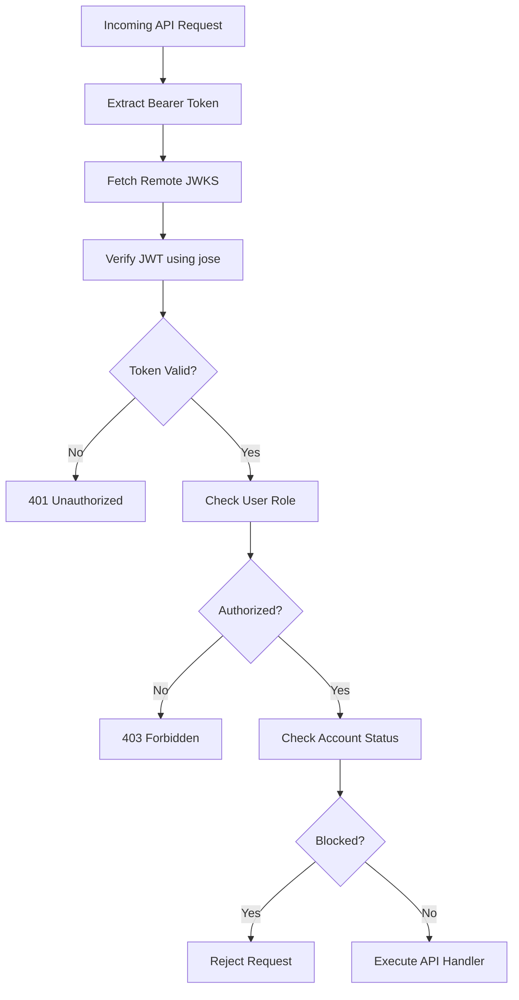
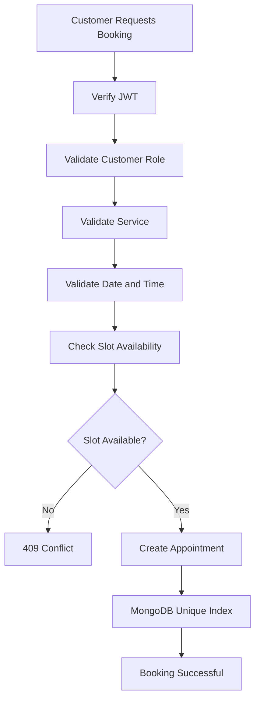
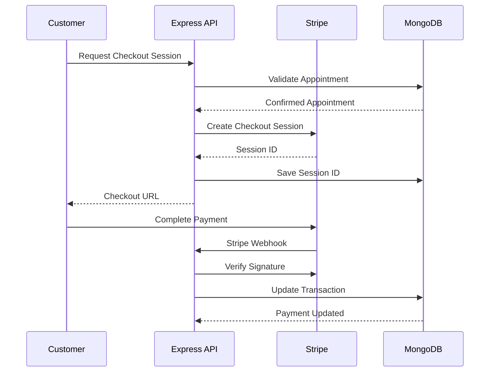

# ⚙️ SalonBook Server

<p align="center">
  <b>Powering SalonBook with a Secure & Scalable REST API</b>
  <br />
  A robust backend API for salon services, appointment management, authentication, and secure online payments.
</p>

<p align="center">
  <a href="https://salon-book-server-123.vercel.app/">
    
  </a>
  <a href="https://github.com/Naimur131251/Salon-Book-Server">
    
  </a>
  <a href="https://github.com/Naimur131251/Salon-Book">
    
  </a>
</p>

<p align="center">
  
  
  
  
  
  
</p>

---

## 🧭 Navigation

<p align="center">
  <a href="#-overview">Overview</a> •
  <a href="#-features">Features</a> •
  <a href="#-technology-stack">Tech Stack</a> •
  <a href="#-architecture">Architecture</a> •
  <a href="#-api-endpoints">API Endpoints</a> •
  <a href="#-installation--setup">Installation</a>
</p>

---

## 🌟 Overview

SalonBook Server is the backend REST API of the SalonBook appointment booking platform.

Built with **Node.js, Express.js 5, and MongoDB**, it handles business logic, appointment scheduling, user authorization, service management, and payment processing.

The API integrates with Better Auth for JWT-based authentication and Stripe for secure online payments.

It provides dedicated API access for three access levels:

- 🌐 Public — Public service browsing and payment-related endpoints.
- 👤 Customer — Appointment booking, personal dashboard, and profile management.
- 🛡️ Admin — Complete management of services, appointments, customers, and transactions.

<details>
  <summary><b>📊 Backend Highlights</b></summary>

  | Component | Details |
  |---|---|
  | API Endpoints | 28 |
  | Access Levels | 3 |
  | Database Collections | 4 |
  | Authentication | Better Auth JWT |
  | Payment Gateway | Stripe |
  | Database | MongoDB |
  | Deployment | Vercel |

</details>

---

## ✨ Features

<details open>
  <summary><b>🌐 Public API Features</b></summary>

  - API health check endpoint.
  - Browse active salon services.
  - Search services by keyword.
  - Filter services by category.
  - Sort services by price.
  - Retrieve featured services.
  - Retrieve individual service details.
  - Stripe webhook event handling.
  - Payment verification endpoint.

</details>

<details>
  <summary><b>👤 Customer Features</b></summary>

  *Requires valid JWT authentication and customer role.*

  **Dashboard**
  - View total appointments.
  - Track pending, confirmed, cancelled, and paid appointments.
  - Retrieve five recent appointments.

  **Appointment Management**
  - Create new appointments.
  - Validate appointment date and time.
  - Prevent booking past dates and time slots.
  - Verify service availability and active status.
  - Prevent double-booking with unique slot indexes.
  - View personal appointments with service details.
  - Cancel pending and unpaid appointments.
  - Release cancelled appointment slots.
  - Check booked time slots for a selected date.

  **Payment Management**
  - Create Stripe Checkout Sessions.
  - Pay for confirmed appointments.
  - Prevent duplicate payments.
  - Check payment status using session ID.

  **Profile Management**
  - Update customer name.
  - Update profile image.
  - Update phone number.
  - Validate Bangladesh mobile number format.

</details>

<details>
  <summary><b>🛡️ Admin Features</b></summary>

  *Requires valid JWT authentication and admin role.*

  **Dashboard Analytics**
  - Total registered customers.
  - Active service statistics.
  - Appointment statistics.
  - Total successful payment revenue.

  **Service Management**
  - Retrieve all services.
  - Create new services.
  - View individual service details.
  - Update existing services.
  - Delete services.
  - Activate or deactivate services.
  - Validate service price, duration, and status.

  **Appointment Management**
  - View all appointments.
  - Retrieve appointment details.
  - Access customer and service information.
  - Confirm pending appointments.
  - Cancel pending or confirmed appointments.
  - Prevent conflicting status updates.

  **Customer Management**
  - View all customers.
  - Retrieve individual customer details.
  - Block customer accounts.
  - Unblock customer accounts.

  **Transaction Management**
  - Retrieve payment transaction history.
  - Access customer and service payment information.
  - Track successful and failed transactions.
  - Calculate total revenue.

  **Profile Management**
  - Update administrator name.
  - Update administrator profile image.

</details>

<details>
  <summary><b>🔐 Authentication & Security</b></summary>

  - Better Auth JWT verification.
  - Remote JWKS integration using `jose`.
  - JWT issuer and audience validation.
  - Role-based authorization.
  - Admin-only and customer-only route protection.
  - Blocked account enforcement.
  - Appointment ownership verification.
  - Race-condition-safe appointment booking.
  - Optimistic concurrency control.
  - Stripe webhook signature verification.
  - Idempotent payment processing.

</details>

---

## 🧰 Technology Stack

### Runtime & Framework

| Technology | Version | Purpose |
|---|---|---|
| Node.js | — | Server runtime |
| JavaScript (ES Modules) | — | Backend development |
| Express.js | 5.3.0 | REST API framework |

### Database

| Technology | Version | Purpose |
|---|---|---|
| MongoDB | 7.9.0 | NoSQL database |
| MongoDB Native Driver | 7.9.0 | Database operations |

### Authentication & Security

| Technology | Version | Purpose |
|---|---|---|
| Better Auth | External integration | JWT authentication |
| jose | 6.2.18 | JWT verification and JWKS |

### Payment Integration

| Technology | Version | Purpose |
|---|---|---|
| Stripe | 23.2.0 | Checkout Sessions and payment verification |

### Middleware & Configuration

| Technology | Version | Purpose |
|---|---|---|
| dotenv | 18.0.10 | Environment configuration |
| cors | 2.8.6 | Cross-origin resource sharing |

### Deployment

| Platform | Purpose |
|---|---|
| Vercel | Serverless API deployment |

---

## 🏗️ Architecture

SalonBook uses a separate frontend and backend architecture.



### Database Structure

The backend uses four primary MongoDB collections:

| Collection | Purpose |
|---|---|
| `services` | Salon service information |
| `appointments` | Customer appointment records |
| `user` | User and authentication-related information |
| `transactions` | Payment and transaction records |

### Backend Project Structure

```text
salon-book-server/
│
├── .gitignore
├── index.js
├── package.json
├── package-lock.json
└── vercel.json
```

| File | Responsibility |
|---|---|
| `index.js` | Express server, API routes, middleware, database and payment logic |
| `package.json` | Dependencies and project configuration |
| `package-lock.json` | Dependency version locking |
| `vercel.json` | Vercel deployment configuration |
| `.gitignore` | Git ignored files |

---

## 🔄 API Workflows

### 1. Authentication Workflow



### 2. Appointment Booking Workflow



### 3. Stripe Payment Workflow



---

## 📡 API Endpoints

The backend exposes 28 endpoints across three access levels.

> All authenticated endpoints require a valid Bearer JWT. Actual endpoint paths and HTTP methods should be checked against `index.js`.

### 🌐 Public Endpoints

| Feature | Access |
|---|---|
| API health check | Public |
| Browse services | Public |
| Search services | Public |
| Filter services | Public |
| Featured services | Public |
| Service details | Public |
| Stripe webhook | Stripe signature |
| Payment verification | Public |

### 👤 Customer Endpoints

| Feature | Access |
|---|---|
| Customer dashboard | Customer |
| Book appointment | Customer |
| View own appointments | Customer |
| Cancel appointment | Customer |
| Check booked slots | Customer |
| Create checkout session | Customer |
| Check payment status | Customer |
| Update profile | Customer |

### 🛡️ Admin Endpoints

| Feature | Access |
|---|---|
| Admin dashboard | Admin |
| List services | Admin |
| Create service | Admin |
| View service | Admin |
| Update service | Admin |
| Delete service | Admin |
| Toggle service status | Admin |
| List appointments | Admin |
| View appointment details | Admin |
| Confirm appointment | Admin |
| Cancel appointment | Admin |
| List customers | Admin |
| View customer | Admin |
| Block / unblock customer | Admin |
| View transactions | Admin |
| Update admin profile | Admin |

---

## ⚙️ Installation & Setup

### Prerequisites

Make sure you have installed:

- Node.js
- npm
- Git
- MongoDB
- Stripe account
- Better Auth configured frontend

### Step 1 — Clone Repository

```bash
git clone YOUR_SERVER_REPOSITORY_URL
```

### Step 2 — Navigate to Project

```bash
cd salon-book-server
```

### Step 3 — Install Dependencies

```bash
npm install
```

### Step 4 — Configure Environment Variables

Create a `.env` file in the project root directory.

Add the required environment variable names and configure your own credentials.

### Step 5 — Start the Server

Use the start command configured in `package.json`.

For example, if `index.js` is your entry point:

```bash
node index.js
```

> If you add a development script such as `npm run dev`, configure it in `package.json` first. The current project does not include a development script according to the package analysis.

---

## 🔑 Environment Variables

Configure the following variables according to your backend implementation.

| Variable | Purpose |
|---|---|
| `PORT` | Server port |
| `BETTER_AUTH_URL` | Better Auth application URL |
| `BETTER_AUTH_DB_URI` | MongoDB connection URI |
| `MONGODB_URI` | MongoDB connection URI, if separately configured |
| `STRIPE_SECRET_KEY` | Stripe secret key |
| `STRIPE_WEBHOOK_SECRET` | Stripe webhook signing secret |
| `STRIPE_CURRENCY` | Payment currency |

**Note:** This is a configuration checklist, not a claim that every variable is independently required. Confirm the exact names against `index.js` before deployment. Never expose actual secret values.

---

## 🚀 Deployment

SalonBook Server is configured for deployment on Vercel.

### Deployment Steps

1. Push the backend project to GitHub.
2. Import the repository into Vercel.
3. Configure the required environment variables.
4. Deploy the project.
5. Update the frontend backend API URL.
6. Configure the Stripe webhook endpoint with the deployed server URL.

### Vercel Configuration

The project uses `vercel.json` to configure the Node.js serverless function and route incoming requests to `index.js`.

---

## 🛡️ Error Handling & Validation

The API implements several validation and error-handling mechanisms:

| HTTP Status | Meaning |
|---|---|
| `200` | Request successful |
| `201` | Resource created |
| `400` | Invalid request |
| `401` | Authentication required |
| `403` | Access forbidden |
| `404` | Resource not found |
| `409` | Booking or update conflict |
| `500` | Internal server error |

---

## 🔗 Project Links

<p align="center">
  <a href="https://salon-book-server-123.vercel.app/">
    
  </a>
  <a href="https://github.com/Naimur131251/Salon-Book">
    
  </a>
  <a href="https://github.com/Naimur131251/Salon-Book-Server">
    
  </a>
</p>

| Resource | Link |
|---|---|
| Live Website | [SalonBook](https://naimur-salon-book.vercel.app/) |
| Live Website | [SalonBook Server](https://salon-book-server-123.vercel.app/) |
| Frontend Repository | [Client GitHub](https://github.com/Naimur131251/Salon-Book) |
| Backend Repository | [Server GitHub](https://github.com/Naimur131251/Salon-Book-Server) |

---

## 👨‍💻 Developer

<p align="center">
  <b>Md Naimur Rahman</b>
  <br />
  Full-Stack Developer & Programming Enthusiast
</p>

---

<p align="center">
  
  <br /><br />
  <b>SalonBook Server</b>
  <br />
  Reliable APIs. Secure Payments. Smarter Appointments.
  <br /><br />
  ⭐ If you find this project useful, consider giving it a star!
</p>
